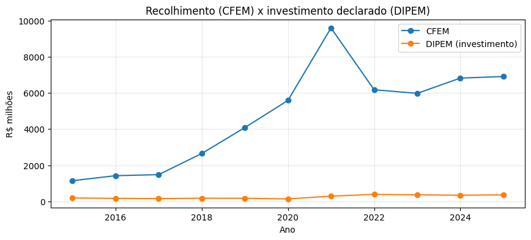

# pocket-lakehouse

A small, self-contained **study platform** for data work, from raw download to chart, on one machine (Docker on WSL):

```
extract ──► transform ──► store ──► analyze
 (HTTP,     (PySpark)     (Parquet   (pandas, DuckDB,
  JDBC)                    on MinIO)   matplotlib)
```

It is deliberately **monolithic**: one repository, one Terraform-managed Docker stack, one lake. Scripts are grouped by
*category* (a folder per theme, see [Adding a category](#5-adding-a-category)); the first one is mining and oil.



**What the first category delivers** ([details](notebooks/mineracao/README.md)):
- **Six PySpark pipelines** over Brazilian open data (ANM mining royalties, production, registry, dams and research
  investment; ANP oil and gas production by well). They run incremental, range, backfill, profile and dry-run modes, use
  ETag/Last-Modified change detection, and write with a two-phase stage → commit, so a failed run never leaves a
  half-written table.
- **Validated against the source:** totals recomputed independently with pandas from the public files match the lake
  (CFEM R$ 55.24 bn, DIPEM R$ 4.28 bn and AMB to the cent).
- **Data issues caught along the way:** pre-salt production counted twice (5.71 vs 3.22 million bbl/day in 2023-01, now
  fixed), and ANP no longer publishing files after 2023.
- **LGPD by design:** individuals are aggregated as `'PF'`, never stored with CPF, name or process number.
- **25 offline tests** plus an integration test against MinIO.

> **What it is not.** There is **no orchestration** (nothing schedules or triggers a run; you start jobs from a notebook or
> the command line) and **no observability** (no metrics, alerting or lineage). The Spark UIs are debugging aids, and the
> `_ctl` JSON files are idempotency bookkeeping, not monitoring. It is a study and prototyping environment, not production.
>
> **To take it to production** I would add an orchestrator (Airflow, Dagster or Windmill) to schedule the flow and retry
> failed branches, a table format with ACID commits (Delta Lake or Iceberg) instead of the folder swap, data-quality
> checks on every load, and alerting on failures and freshness.

> **Safety rule:** nothing here connects to a production database. Data goes to MinIO only.

## Contents

1. [Overview](#1-overview)
2. [Repository layout](#2-repository-layout)
3. [Infrastructure (containers)](#3-infrastructure-containers)
4. [Start, use and stop](#4-start-use-and-stop)
5. [Adding a category](#5-adding-a-category)
6. [Storage: MinIO and the disk quota](#6-storage-minio-and-the-disk-quota)
7. [Environment variables](#7-environment-variables)
8. [Hardware limits and troubleshooting](#8-hardware-limits-and-troubleshooting)
9. [License](#9-license)

---

## 1. Overview

```
                   sources (HTTP / JDBC)                        WSL / Docker
        ┌──────────────────────────────────────┐   ┌──────────────────────────────────────────────┐
        │ ANM  CFEM  AMB  SCM  SIGBM  DIPEM    │   │ spark-jupyter ──► Spark (master + 2 workers) │
        │ ANP  well production                 │──►│       │  pandas / DuckDB / pipelines/        │
        │ IBGE municipalities (API)            │   │       ▼  S3A                                 │
        │ CPTEC MERGE (GRIB2)  NASA POWER      │   │     MinIO  bucket "lake"  (quota 5 GiB)      │
        │ RF CNPJ  CVM  PGFN  CGU  MTE         │   │       └─ estudo/<table>/*.parquet, _ctl/     │
        │ PNCP (API / CSV)  CAGED (FTP)        │   └──────────────────────────────────────────────┘
        └──────────────────────────────────────┘
```

| Stage | Tools |
|---|---|
| **Extract** | Python/`requests` for open data; Spark JDBC (`apps/extract_jdbc.py`) for SQL Server, Postgres and MySQL |
| **Transform** | PySpark, native functions only |
| **Store** | Parquet on MinIO (S3 API); local-disk storage is disabled |
| **Analyze** | pandas, DuckDB (SQL over DataFrames and Parquet), matplotlib, in JupyterLab |

---

## 2. Repository layout

```
pocket-lakehouse/
├── README.md                    this file
├── terraform/                   the whole stack as code: MinIO + Spark cluster + JupyterLab (+ optional MCP, autoheal); tunables in variables.tf
├── Dockerfile                   Spark image (JDBC drivers for SQL Server/Postgres/MySQL; S3A for MinIO)
├── Dockerfile.jupyter           Jupyter image (JupyterLab, pandas, pyarrow, matplotlib, s3fs, DuckDB, openpyxl, py7zr)
├── scripts/init-minio.sh        creates the bucket, the quota and the MCP users (idempotent; run by Terraform)
├── minio.env / s3.env           credentials (git-ignored; copy the *.example files)
├── apps/                        spark-submit scripts: smoke tests and a generic JDBC extractor
├── data/                        local area: raw/ (temporary downloads) and ref/ (IBGE cache)
├── minio-data/                  where MinIO keeps its objects (git-ignored)
├── event-logs/                  Spark event logs (feed the history server)
└── notebooks/                   mounted at /notebooks in Jupyter — one folder per category
    ├── lakehouse/               shared code of the newer categories: storage, _ctl, HTTP, size guard (core.py)
    ├── mineracao/               category: mining & oil public data (see its README)
    ├── clima/                   category: daily rain and weather per municipality (MERGE, NASA POWER, IBGE)
    └── empresas/                category: companies — CNPJ, CVM, PGFN, CGU, MTE, PNCP, CAGED
```

---

## 3. Infrastructure (containers)

Everything is in `terraform/` (variable `project` = `spark`, network `spark_spark`). Spark's configuration is the template
`terraform/templates/spark-defaults.conf.tftpl`, rendered with the cluster tunables and uploaded into each Spark container.

| Container | Role | Host ports | Memory limit |
|---|---|---|---|
| `minio` | S3-compatible storage | API **9000**, console **9001** (both `127.0.0.1` only) | 512 MB |
| `spark-master` | coordinates the (standalone) cluster | UI **8090**, 7077 | 512 MB |
| `spark-worker-1` | runs tasks: 2 cores, 2 GB for executors | UI **8091** | 2.5 GB |
| `spark-worker-2` | same | UI **8092** | 2.5 GB |
| `spark-history` | shows finished jobs (reads `event-logs/`) | **18080** | 640 MB |
| `spark-client` | container for `spark-submit` (client mode / driver) | 4040 (job UI) | 1.5 GB |
| `spark-jupyter` | JupyterLab with PySpark; the notebooks run from here | **8888**, 4041 (job UI) | 2 GB |
| `autoheal` | restarts containers that turn `unhealthy` — **opt-in**, `autoheal_active=1` | — | 32 MB |
| `mcp` | MCP server over the lake — **opt-in**, `mcp_active=1` (see [section 4.1](#41-tunables)) | **8765** (`127.0.0.1`) | 768 MB |

The Spark UIs are published on host ports 8090–8092 so they do not clash with other local services on 8080/8081.

**Sizing (important):** each worker runs **1 executor with 2 cores and 1.5 GB**. Cluster total: **4 cores** and
**2 × 1.5 GB** for tasks. Four 1 GB executors would exceed the 2.5 GB container limit. A notebook session asks for
`cores_max=2` by default so a `spark-submit` can run alongside it.

**MinIO image:** `cgr.dev/chainguard/minio` (MinIO no longer publishes official images on Docker Hub/quay.io without a
login). Chainguard images have no shell, so the bucket and quota are created by `scripts/init-minio.sh`, which runs the
`mc` client through the `MC_HOST_local` variable.

**How containers see each other:** all share the Docker network `spark_spark`. Spark and Jupyter reach MinIO at
`http://minio:9000`. Credentials arrive through `AWS_ACCESS_KEY_ID` / `AWS_SECRET_ACCESS_KEY` (`s3.env`); Spark uses the
**S3A** connector (`hadoop-aws 3.3.4`, matching the Hadoop bundled with Spark 3.5.9) and Python uses `s3fs`.

**Versions:** Spark 3.5.9 on Java 11, Python 3.10 (Ubuntu 22.04, from the official `apache/spark` image). The driver
(Jupyter) and the executors run the same Python, as PySpark requires.

---

## 4. Start, use and stop

First time only: create the credential files and pick a password.
```bash
cp minio.env.example minio.env      # edit: MINIO_ROOT_USER / MINIO_ROOT_PASSWORD
cp s3.env.example s3.env            # edit: same values as AWS_ACCESS_KEY_ID / AWS_SECRET_ACCESS_KEY
```

```bash
cd terraform
terraform init                      # first time only
terraform apply                     # builds the images, starts everything, creates the bucket, quota and MCP users
terraform output                    # URLs and the capacity the tunables add up to

# stop (frees RAM; data stays in ./minio-data)
terraform destroy
```

Change a tunable with `terraform apply -var worker_count=3`, or put it in `terraform/terraform.tfvars` (copy
`terraform.tfvars.example`). `terraform plan` shows what a change would recreate before anything happens.

| I want… | Address |
|---|---|
| Notebooks | http://localhost:8888 (no password, local only) |
| MinIO console | http://localhost:9001 (user/password in `minio.env`) |
| Master / workers UI | http://localhost:8090 · :8091 · :8092 |
| Finished jobs | http://localhost:18080 |
| Running job | http://localhost:4040 (spark-client) or :4041 (Jupyter) |

Quick cluster test:
```bash
docker exec spark-client /opt/spark/bin/spark-submit --master spark://spark-master:7077 /apps/smoke_test.py   # computation
docker exec spark-client /opt/spark/bin/spark-submit --master spark://spark-master:7077 /apps/s3_smoke.py    # writes/reads MinIO
```

### 4.1 Tunables

All of them are variables in `terraform/variables.tf` (with validation); the table lists the ones you will change.

| Variable | Default | Effect |
|---|---|---|
| `autoheal_active` | `0` | `1` deploys `autoheal` (needs the Docker socket, which is root-equivalent on the host, hence opt-in) |
| `mcp_active` | `0` | `1` deploys the MCP server at `http://127.0.0.1:8765/mcp` (Streamable HTTP) |
| `mcp_edit_access` | `0` | only with `mcp_active=1`. `0` = **read-only**; `1` = the agent may also write and delete in the bucket |
| `minio_quota_gib` | `5` | hard quota of the bucket; also handed to the pipelines' size guards (`QUOTA_GIB`), so they always agree |
| `worker_count` | `2` | Spark workers; `spark.cores.max` is computed as `worker_count × worker_cores`, so a new worker adds capacity |
| `worker_cores` | `2` | cores per worker (one executor per worker uses them all) |
| `worker_memory_mb` / `executor_memory_mb` | `2048` / `1536` | memory a worker offers / each executor takes (validated: executor ≤ worker) |
| `*_memory_mb` | see file | container limit of minio, master, history, client, jupyter, mcp |
| `host_port_offset` / `project` | `0` / `spark` | shift every published port / prefix container and network names, to run a second copy beside the first |

```bash
cd terraform && terraform apply -var mcp_active=1
claude mcp add --transport http lakehouse http://127.0.0.1:8765/mcp
```

Setting a switch back to `0` and applying removes the container. The state file (`terraform/terraform.tfstate`, git-ignored)
holds the credentials: keep it out of git and off shared disks.

**Tools:** `list_tables`, `describe_table`, `query` (DuckDB SQL over the Parquet, e.g.
`SELECT … FROM read_parquet('s3://lake/estudo/<table>/**/*.parquet', hive_partitioning=true)`), `lake_usage` (bucket use
against the quota). With `mcp_edit_access=1` there is also `delete_table`, and `query` accepts any statement
(`COPY … TO 's3://lake/…'`, `CREATE`, …).

**Credentials.** `scripts/init-minio.sh` (run by Terraform) creates two MinIO users, each with a policy limited to the one bucket:

| Mode | Password | User | Can |
|---|---|---|---|
| read-only (default) | variable `mcp_reader_password` (default `mcp-readonly-default`) | `mcp-reader` | list and read the bucket |
| edit | random, generated by Terraform and kept in the state | `mcp-editor` | also write and delete |

Read-only is enforced in three layers: MinIO denies writes to `mcp-reader` (`AccessDenied`, tested), the server accepts only
`SELECT`/`DESCRIBE`, and DuckDB is locked to `s3://lake/` so a query cannot read the container's own files (the container
filesystem is read-only too). Rows are capped (`MCP_ROW_LIMIT`, 1000) and queries stop after `MCP_TIMEOUT_S` (60 s).
There is **no authentication** on the endpoint: it is published on `127.0.0.1` only, like Jupyter, so treat edit mode
accordingly. Writes still hit the bucket's hard quota.

---

## 5. Adding a category

A **category** is a folder of scripts and notebooks about one theme. Categories are independent of each other and share
only the infrastructure and the lake.

```
notebooks/<category>/
├── README.md            what the category does: sources, tables, how to run
├── NN_name.ipynb        notebooks (numbered in reading order)
├── run.py               optional command-line entry point
├── <package>/           optional reusable code (e.g. pipelines/)
└── tests/               optional unit tests
```

Conventions that keep categories from colliding:
- **Tables:** write to `s3a://lake/<target_db>/<table>/` with a category-specific table prefix (mining uses `anm_*`, `anp_*`).
- **Run inside the Jupyter container**, from the category folder: `docker exec spark-jupyter bash -c "cd /notebooks/<category> && python3 run.py …"`.
- **Tests:** `python3 -m unittest tests.<module>`, one command per module (see the mining README for why).
- **No secrets in notebooks or code**; credentials come from the environment.
- **Notebooks created from the host** need `chmod -R a+rwX notebooks/<category>` so the container can write to them.

Categories can be developed and published one at a time: each lives in its own folder, so adding `notebooks/finance/`
does not touch `notebooks/mineracao/`.

Current categories:

| Category | What it holds |
|---|---|
| [`mineracao`](notebooks/mineracao/README.md) | ANM / ANP public data (mining and oil): six PySpark pipelines, tests, and an analysis notebook |
| [`clima`](notebooks/clima/README.md) | daily rain/weather per IBGE municipality: CPTEC MERGE (GRIB2), NASA POWER, IBGE centroids |
| [`empresas`](notebooks/empresas/README.md) | companies: RF CNPJ, CVM statements, PGFN debtors, CGU sanctions, MTE Lista Suja, PNCP procurement, Novo CAGED |

`clima` and `empresas` share `notebooks/lakehouse/core.py` (their `pipelines/__init__.py` puts `notebooks/` on the path);
`mineracao` predates it and keeps its own `pipelines/common.py`.

---

## 6. Storage: MinIO and the disk quota

- Single bucket: **`lake`**. Each pipeline writes to `s3a://lake/<target_db>/<table>/`.
- **`target_db` is not a database**: it is only a **folder (prefix)** inside the bucket. Every pipeline defaults to
  `target_db="estudo"`, so a plain run writes to `s3a://lake/estudo/<table>/` — where the project's data lives. Pass
  another name (e.g. `target_db="teste"`) to keep a trial load apart, then delete that folder.
- **Hard 5 GiB quota** on the bucket. Without sudo a fixed-size partition cannot be created on the host, so the limit is
  MinIO's native quota: uploads beyond it fail with `Bucket quota exceeded` (tested). To change it:
  `terraform apply -var minio_quota_gib=10`.
- The quota counts only the bucket content. The MinIO process and temporary downloads in `data/raw` are not counted.
- During an *upsert* load there are temporary copies of the table (`.__stage`, `.__merge`), so usage can exceed the final
  size for a few moments.
- Tables are stored **only in MinIO**. Writing tables to local disk is disabled (the code refuses `STORAGE=file`; only the offline tests enable it).
- Current use with all the real data: ~139 MiB.
- **Size guards (clima, empresas):** each pipeline estimates its write before downloading and refuses one that would not fit
  in the free quota (`ignorar_cota=True` skips the estimate; `QUOTA_GIB` tells the code the quota if you change it). If the
  hard quota still stops a write, the stage is removed and the live table is kept. Sources that do **not** fit whole: the
  RF CNPJ release (~7 GB zipped — load with `ufs`/`parts`) and the full Novo CAGED history (~80 MB per month).

---

## 7. Environment variables

| Variable | Default | Effect |
|---|---|---|
| `STORAGE` | `s3` | where tables are written; only `s3` (MinIO) is accepted |
| `S3_BUCKET` | `lake` | MinIO bucket |
| `S3_ENDPOINT` | `http://minio:9000` | S3 endpoint |
| `AWS_ACCESS_KEY_ID` / `AWS_SECRET_ACCESS_KEY` | from `s3.env` | MinIO credentials |
| `DATA_ROOT` | `/data` | temporary downloads (`raw/`) and the IBGE cache (`ref/`); never the tables |
| `CONTACT_EMAIL` | — | optional: added to the `User-Agent` of the download requests so publishers can reach you; set it in `s3.env` |
| `PAUSA_S` | `3` | pause (seconds) between requests to the same publisher |
| `KEEP_RAW` | — | `1` keeps the downloads in `data/raw` after a run |
| `QUOTA_GIB` | `5` | bucket quota assumed by the size guards of `clima`/`empresas` (set by Terraform from `minio_quota_gib`) |

---

## 8. Hardware limits and troubleshooting

- **RAM:** developed on WSL 2 with ~15 GB. Container limits add up to ~10 GB at the ceiling, but idle use is
  ~1.3 GB. Stop the stack (`terraform destroy`) when not in use.
- **Jupyter with 2 GB:** small/medium tables fit in pandas; very large ones (e.g. `anm_scm_evento`, 2 M rows) need
  `columns=`/`filters=`, DuckDB straight on the Parquet, or Spark.
- **Cores:** 4 in total. A session asks for 2 by default; use `--cores 4` / `cores_max=4` for heavy jobs (and nothing else running).
- **MinIO quota full:** writes fail with `Bucket quota exceeded`. Delete test prefixes or raise `minio_quota_gib`.
- **File permissions when editing notebooks from the host:** the container runs as another user (uid 185). A file the host
  rewrites as `644` opens read-only in Jupyter; fix with `chmod a+rw <file>` or `chmod -R a+rwX notebooks/<category>`.
  Files created by the container may not be removable by the host (run the `rm` through `docker exec`).
- **`docker exec` with a script on stdin** needs `-i`; the container's `/tmp` has files from another user — prefer
  `docker cp` to `/notebooks/` and delete afterwards.
- **Port in use:** set `host_port_offset`, or change the `ports` blocks in `terraform/*.tf` (the Spark UIs already avoid 8080/8081).
- **Changed a Dockerfile?** The Jupyter image is built on top of the Spark image: `terraform apply` (it rebuilds the images when a Dockerfile changes).
  Packages installed by hand with `pip` inside a container are lost when it is recreated.
- **Credentials:** `minio.env`, `s3.env`, `terraform.tfvars` and the Terraform state are git-ignored; MinIO's console and API listen only on `127.0.0.1`.

---

## 9. License

[MIT](LICENSE). The data comes from Brazilian open-data portals (ANM, ANP, IBGE) under their own terms.
